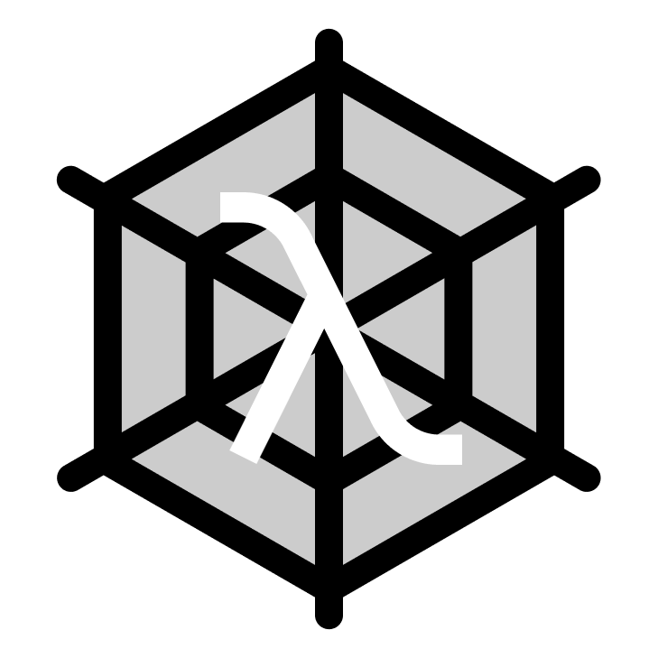

<div align="center">



# WebAlph

**Build tiny, blazingly fast desktop apps with web frontends and pure Alpha backends.**  
*A lightweight, native alternative to Tauri & Electron for the Alpha programming language.*

[](#)
[](#)
[](#)
[](#)

[Features](#-features) •
[Quickstart](#-quickstart-in-60-seconds) •
[Frontend Integration](#-frontend-integration) •
[Documentation](#-documentation) •
[Examples](#-running-the-demo)

---

</div>

## 🌟 Features

- 🪶 **Tiny Memory Footprint**: No bundled Chromium! Uses your OS's native web engine (Edge WebView2 on Windows, WebKit on macOS/Linux).
- 🚀 **Pure Alpha Backend**: Write robust, statically typed `@strict` backend code in Alpha without leaving the language ecosystem.
- ⚡ **Zero-Setup IPC**: Bidirectional messaging out of the box:
  - `window.webalph.invoke(cmd, args)`: Async RPC calls with native `Promise` resolution.
  - `window.webalph.emit(event, payload)`: Fire-and-forget events to the Alpha backend.
  - `window.webalph.listen(event, callback)`: Listen for real-time events streamed from Alpha.
- 🔄 **Modern Frontend Support**: Works seamlessly with React, Vue, Svelte, Solid, or vanilla HTML/CSS/JS. Supports Vite dev servers with instant Hot Module Replacement (HMR).
- 📦 **Modular Architecture**: Separate modules for Window management, Event Bus, IPC routing, and App controller.

---

## 🖥️ Supported Platforms

| Operating System | Engine Backend | Technology | System Dependencies |
|---|---|---|---|
| **Windows 10 / 11** | Edge WebView2 | `wry` + `tao` (Win32 / COM) | Pre-installed on Windows 10/11 |
| **macOS 10.15+** | Apple WebKit (`WKWebView`) | `wry` + `tao` (Cocoa) | Built-in (no extra packages needed) |
| **Linux (X11 / Wayland)** | WebKitGTK (`webkit2gtk-4.1`) | `wry` + `tao` (GTK3) | `libwebkit2gtk-4.1-dev` |

---

## ⚡ Quickstart in 60 Seconds

### 1. Minimal Application (`src/main.alpha`)

Create a minimal Alpha script in 5 lines of code:

```alpha
import Core/Basic.alpha
import "../../src/lib.alpha"

function main() [here, nothing] {
    // 1. Create a 800x600 window
    var app: App = App.new("My First WebAlph App", 800, 600, "")

    // 2. Set inline HTML content
    app.with_html("<html><body style='background:#121212; color:#fff; display:flex; justify-content:center; align-items:center; height:100vh; font-family:sans-serif;'><h1>Hello from Alpha! ⚡</h1></body></html>")

    // 3. Run native event loop
    app.run()
}
```

Run it immediately:
```bash
alpha run src/main.alpha
```

---

### 2. Full RPC Example (Alpha Backend + HTML/JS UI)

#### Backend (`src/main.alpha`):
```alpha
import Core/Basic.alpha
import Core/Json.alpha
import "../../src/lib.alpha"

// Define a command callable from JavaScript
function handle_add(args: map<string, something>) [here, int] {
    var a: int = args["a"]
    var b: int = args["b"]
    return a + b
}

function main() [here, nothing] {
    var app: App = App.new("Calculator", 500, 400, "ui/index.html")

    // Register command "add"
    app.command("add", handle_add)

    app.run()
}
```

#### Frontend (`ui/index.html`):
```html
<!DOCTYPE html>
<html>
<head>
  <style>
    body { background: #1e1e2e; color: #cdd6f4; font-family: sans-serif; text-align: center; padding: 40px; }
    button { background: #89b4fa; color: #11111b; border: none; padding: 10px 20px; font-weight: bold; border-radius: 6px; cursor: pointer; }
  </style>
</head>
<body>
  <h2>Calculate in Alpha Backend</h2>
  <button onclick="calculate()">Compute 25 + 17</button>
  <h3 id="result">Result will appear here</h3>

  <script>
    async function calculate() {
      // Invoke command registered on Alpha backend
      const sum = await window.webalph.invoke('add', { a: 25, b: 17 });
      document.getElementById('result').innerText = `Answer: ${sum}`;
    }
  </script>
</body>
</html>
```

---

## 🎨 Frontend Integration

### JavaScript / TypeScript API

The `window.webalph` global object is injected automatically into every window:

```typescript
// 1. Asynchronous RPC command
const reply = await window.webalph.invoke('command_name', { key: 'value' });

// 2. Send fire-and-forget event to Alpha
window.webalph.emit('user_action', { action: 'button_clicked' });

// 3. Listen for real-time events emitted by Alpha
window.webalph.listen('download_progress', (data) => {
    console.log(`Progress: ${data.percent}%`);
});
```

### Vite / React / Vue Dev Mode (Live Reload)

During development, point your Alpha window to the local Vite dev server:

```alpha
var app: App = App.new("My React App", 1024, 768, "http://localhost:5173")
app.run()
```
Enjoy blazing-fast Hot Module Replacement (HMR) inside your native desktop window!

---

## 📁 Repository Structure

```
D:\AlphaProjects\webalph/
├── alpha-project.toml        # Library manifest
├── packages.alpaks           # Dependency configuration
├── README.md                 # English documentation overview
│
├── src/                      # Pure Alpha library source modules
│   ├── lib.alpha             # Entry point (create_app & re-exports)
│   ├── app.alpha             # High-level App structure & lifecycle
│   ├── window.alpha          # Window configuration structure
│   ├── ipc.alpha             # JSON-RPC dispatcher
│   └── events.alpha          # Bi-directional event bus
│
├── docs/                     # Comprehensive documentation
│   ├── STEP_BY_STEP_GUIDE.md    # 🇷🇺 Пошаговое руководство с нуля (Russian)
│   ├── STEP_BY_STEP_GUIDE_EN.md # 🇬🇧 Step-by-Step Beginner Guide (English)
│   ├── API.md                   # Full API Reference with isolated examples
│   ├── FRONTEND_GUIDE.md        # Frontend & TypeScript developer guide
│   └── ARCHITECTURE.md          # Internal runtime design & IPC wire format
│
└── examples/
    └── basic_app/            # Complete runnable demo application
        ├── src/main.alpha    # Annotated Alpha backend
        └── ui/               # Modern dark-mode web interface
            ├── index.html
            ├── style.css
            └── app.js
```

---

## 🚀 Running the Demo

Test the included interactive example right away:

```bash
cd D:\AlphaProjects\webalph\examples\basic_app
alpha run src/main.alpha
```

---

## 📚 Documentation

- 🇷🇺 **[Пошаговое руководство с нуля (Russian)](docs/STEP_BY_STEP_GUIDE_RU.md)** — Подробнейший гайд от создания первого окна до готового приложения.
- 🇬🇧 **[Step-by-Step Guide from Scratch (English)](docs/STEP_BY_STEP_GUIDE_EN.md)** — A beginner-friendly tutorial explaining everything step-by-step.
- 📘 **[API Reference](docs/API.md)** — Method signatures, parameter descriptions, and isolated examples.
- 🎨 **[Frontend Developer Guide](docs/FRONTEND_GUIDE.md)** — React, Vue, Svelte integration & TypeScript typings.
- ⚙️ **[Architecture & Protocol](docs/ARCHITECTURE.md)** — IPC wire specification, EventLoop lifecycle, and WebView2 bindings.

---

## 📄 License

Licensed under the [MIT License](LICENSE).
